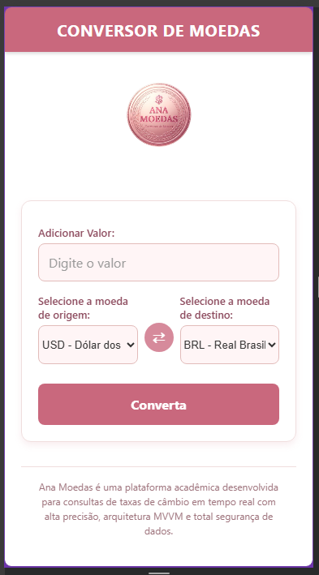
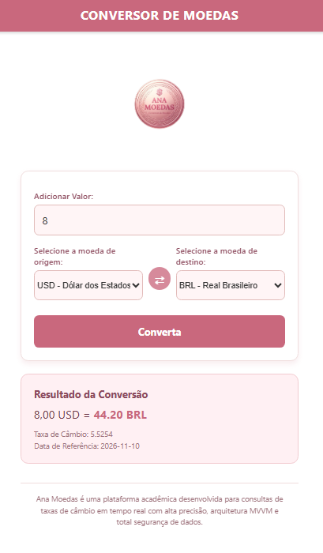
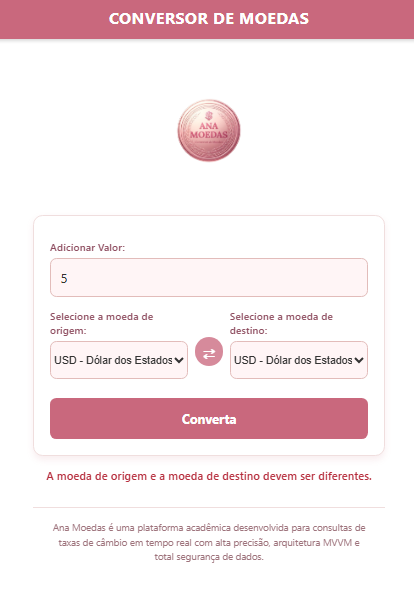

## Ana Moedas - Conversor de Moedas

Plataforma acadêmica de conversão de câmbio em tempo real, desenvolvida em React Native com arquitetura MVVM.

## Sobre o Projeto

O Ana Moedas é um aplicativo moderno voltado para consultas rápidas e precisas de taxas de câmbio. O sistema consome dados atualizados diretamente da API pública Frankfurter, garantindo confiabilidade nas cotações e uma experiência de usuário fluida.   

## Tecnologias Utilizadas

O projeto foi construído empregando as seguintes ferramentas e padrões de mercado:

React Native / Expo (Framework principal em JavaScript),  
Arquitetura MVVM (Model-View-ViewModel),   
Frankfurter API (Fonte de dados de câmbio),   
React Native Picker (Componente interativo de seleção de moedas),   

## Arquitetura e Estrutura de Pastas

Seguindo estritamente os padrões de separação de responsabilidades do padrão MVVM, o projeto está organizado da seguinte forma:

    ConversorMoedasLimpo/
    ├── assets/
    │   └── logo.png
    ├── src/
    │   ├── models/
    │   ├── viewmodels/
    │   └── views/
    ├── App.js
    └── package.json

## Funcionalidades Principais

Cotação em Tempo Real: 
Consulta instantânea de taxas de câmbio oficiais.   

Seleção Dinâmica: Listagem completa de moedas de origem e destino acompanhadas de seus respectivos países e códigos.   

Inversão Ágil: Botão centralizado para inverter instantaneamente a direção da conversão.

Validação de Entrada: Tratamento rigoroso de dados numéricos digitados pelo usuário.   

Feedback de Estados: Indicadores visuais de carregamento (ActivityIndicator) e mensagens controladas de erro.   

Identidade Visual: Design exclusivo em tons de rosa e branco, com cabeçalho em barra, logo de destaque e rodapé informativo.
---
## Instalação e Execução

Siga o passo a passo abaixo para rodar o projeto localmente:

1. Pré-requisito 
Certifique-se de ter instalado em sua máquina:Node.js (versão LTS recomendada)npm ou yarnExpo CLI

2. Clonar o repositório 
git clone https://github.com/c44rolina/ana-moedas.git
cd ana-moedas

3. Instalar as dependências
 npm install

4. Iniciar a aplicaçãoBashnpx expo start
(Pressione w no terminal para abrir diretamente no navegador ou utilize o aplicativo Expo Go no seu smartphone via QR Code).

## Capturas de Tela
demonstrando o aplicativo em funcionamento

Tela Principal

Teste funcional

Tratamento de erros

## Autoria
Nome: Ana Carolina   

Contexto: projeto desenvolvido para a matéria de Programação para Dispositivos Mobile.   

