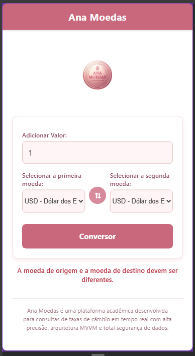
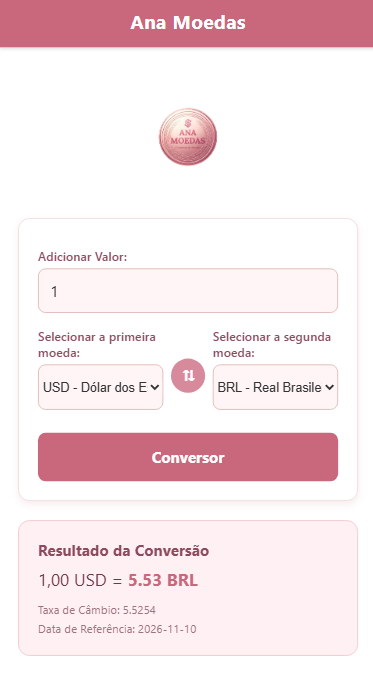

Ana Moedas - Conversor de Moedas
O Ana Moedas é um aplicativo móvel desenvolvido em React Native (com suporte web/Expo) que realiza a conversão de moedas em tempo real utilizando a API pública Frankfurter. O projeto foi construído seguindo rigorosamente os padrões de arquitetura limpa, separação de responsabilidades e o padrão MVVM (Model-View-ViewModel).

Tecnologias e Ferramentas Utilizadas
React Native / Expo (JavaScript)

MVVM Architecture (Separação entre Model, View e ViewModel)

Frankfurter API (Dados de câmbio atualizados)

React Native Picker (Seleção interativa de moedas)

Estrutura de Pastas (MVVM)
O projeto está organizado de forma modular e limpa para garantir a manutenibilidade:
ConversorMoedasLimpo/
├── assets/
│   └── logo.jpg          # Logo personalizada do aplicativo
├── src/
│   ├── models/           # Lógica de requisição à API e manipulação de dados
│   ├── viewmodels/       # Gerenciamento de estado, regras de negócio e validações
│   └── views/            # Componentes de interface do usuário (UI)
├── App.js                # Ponto de entrada da aplicação
└── package.json          # Dependências do projeto

Funcionalidades Principais
Conversão em Tempo Real: Consulta taxas de câmbio oficiais atualizadas pela Frankfurter API.

Seleção Dinâmica: Listagem completa de moedas com códigos e descrições dos países.

Inversão Rápida: Botão centralizado para inverter de forma ágil a moeda de origem e destino.

Validação de Entrada: Tratamento robusto para valores numéricos e digitação (aceitando ponto/vírgula).

Feedback Visual: Estados de carregamento (ActivityIndicator) e mensagens amigáveis de erro.

Identidade Visual: Design personalizado nas cores rosa e branco com cabeçalho em faixa, logo centralizada e rodapé descritivo.

Instruções para Instalar e Executar
Siga os passos abaixo para rodar o projeto em sua máquina:

Pré-requisitos
Certifique-se de ter instalado em seu computador:

Node.js (versão LTS recomendada)

npm ou yarn

Expo CLI (ou rodar via npx)

Passo a passo
Clone o repositório ou descompacte a pasta do projeto:git clone https://github.com/seu-usuario/ana-moedas.git
cd ana-moedas

Instale as dependências do projeto:npm install

Inicie a aplicação (Expo):npx expo start

Pressione w para abrir no navegador web, ou utilize o aplicativo Expo Go no seu smartphone escaneando o QR Code gerado no terminal.

Capturas de Tela do Aplicativo

Desenvolvedora
Ana Carolina

Projeto Acadêmico – Desenvolvimento Mobile / Engenharia de Software.